<!-- SPDX-License-Identifier: GPL-3.0-only -->
<!-- Copyright (C) 2026 Yakov Khalinsky -->
# Tessera-OC: the panel and the controls

This guide covers the firmware on `main`: release **v0.1.2** plus phase 1 of
the UI plan ([UI-PLAN.md](UI-PLAN.md)), which is not released yet. Phase 1c
wired the new input core and the screen router into the firmware, so the
controls and the screens below are the ones a build of `main` has.

The screen pictures are not mock-ups. `tools/render_screens` builds the
firmware's own drawing code (`firmware/oc_display.cpp`, `oc_ui.cpp`,
`oc_diag.cpp`) and the engine for the host, and writes the display's 128 × 64
pixels out at three times the size. `tools/build_host.sh`, which CI runs on
every push, renders them again and fails if they differ from the files here
(see the end of this guide).

## The panel

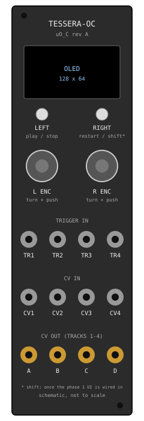

From the top: the display; the **LEFT** and **RIGHT** buttons side by side under
it; the **L** and **R** encoders; then the trigger inputs, the CV inputs and the
outputs. The code calls the LEFT button **TOP** and the RIGHT button **BOTTOM**.
Which pin each one is comes from the calibration, not from a fixed pin: the
`FLIPCONTROLS` flag picks the plain or the flipped pinout
(`firmware/oc_platform.cpp:548`, the tables at `firmware/oc_port.h:137-138`).
LEFT is play / stop as calibrated.

| Control or jack | What it does on `main` |
|---|---|
| **L encoder, turn** | moves the cursor up and down the list (it wraps round). It never changes the track, except on OVERVIEW, where the cursor on a `TRACK` row selects that track |
| **L encoder, tap** | back: closes the screen shown (at OVERVIEW it does nothing) |
| **L encoder, long press** (600 ms) | opens the screen menu |
| **R encoder, turn** | changes the value in the row under the cursor. A fast turn takes bigger steps (2, 4 or 8 a detent) on a wide range; turned while pushed in it is one step a detent; a list of names is always one step |
| **R encoder, tap** | enter: on an OVERVIEW `TRACK` row it opens TRACK; on PROJECT it loads the slot |
| **R encoder, long press** | on TRACK: puts the row's value back to its default |
| **LEFT button** (TOP in the code) | play / stop |
| **RIGHT button** (BOTTOM in the code) | a tap restarts from the top. Held, it is a shift for the other controls (below). Held at power-on, it starts the **safe mode** |
| **RIGHT + L turn** | selects the track (1 – 4, it wraps round), on every screen |
| **RIGHT + R turn** | the tempo, on every screen but PERFORM (nothing while the clock follows TR1) |
| **RIGHT + R tap** | on TRACK: the next tab (GEN, SCL, CV, MOD) |
| **LEFT + RIGHT** together (within 40 ms) | opens PERFORM, and closes it again |
| **TR1** | clock in: the rig's clock, counted on the falling edge |
| **TR2 – TR4** | read, but not used |
| **CV1 – CV4** | not used |
| **A – D** | the CV outs, tracks 1 – 4: the pitch at 1 V an octave, with the gate riding on the same CV (see the README's *The outputs*) |

The module has no gate jacks, no digital outs and no MIDI out.

The controls are read 1000 times a second by a timer of their own
(`ui_start` and `ui_service` in `firmware/oc_ui.cpp`), which never delays the
engine's tick by more than about a microsecond.
A press counts after 5 ms; a press up to 400 ms is a tap. A button held through
the power-on does nothing until it has been let go.

The footers use short names: `L` and `R` are the encoders' turns, `LP` and
`RP` their pushes, `LL` a long L push and `RB` the RIGHT button.

## Power-on

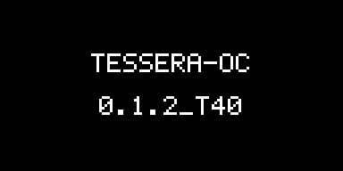

At power-on the module shows these screens in order:

1. If the framework has a **crash report**, the crash pager comes first (see
   below). Otherwise, if the last boot stopped part of the way through, the
   module shows `RESET AT STAGE n` for five seconds.
2. The **splash**: the module's name and the firmware's version.
3. **OVERVIEW** (its top line says `HOME`). If nothing is saved, the module
   composes for itself: track 1 gets TURING, 2 gets EUCLID, 3 MARKOV and 4
   MORPH, an octave apart, and it plays.

## OVERVIEW

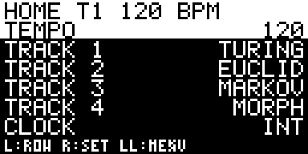

The top line shows the selected track and the tempo. The bottom line is the
footer.

| Row | R encoder turn | R tap |
|---|---|---|
| `TEMPO` | the tempo, from 40 to 240 BPM (faster turns, bigger steps) | nothing |
| `TRACK 1` – `TRACK 4` | changes that track's generator (STEP, TURING, EUCLID, MARKOV, MORPH, ATLAS, BOUNCE, AWAKE, POLY, QUAD, CONSTL, SERIES, CHORD, ANSWER). It stops at the ends of the list | opens TRACK for that track |
| `CLOCK` | nothing: it only shows `INT` (the module's own tempo) or `EXT` (following TR1) | nothing |

When the L encoder's cursor lands on a `TRACK` row, that track becomes the
selected one (`T1` – `T4` on the top line).

## The screen menu

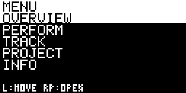

An L long press opens it from any screen. The L encoder moves the `>`, an R
tap opens the screen, an L tap closes the menu.

## TRACK

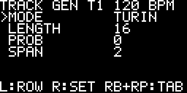

The selected track's parameters, on four tabs: **GEN** (the generator's own
knobs), **SCL** (the scale), **CV** (the CV out) and **MOD**. RIGHT + R tap goes
to the next tab. The R encoder sets the row's value; an R long press puts it
back to its default.

## PERFORM

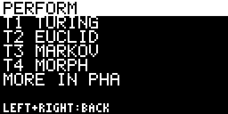

LEFT + RIGHT together opens it, and closes it again. In this phase it shows the
four tracks' generators; the performance controls (mute, fill, the EVOLVE
amount on RIGHT + R) come in phase 5.

## PROJECT

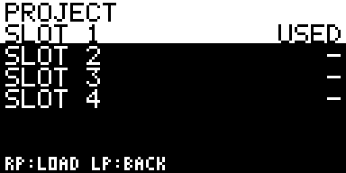

The four slots a project is kept in. An R tap loads the slot under the cursor.
The storage is read only, so there is no save. Without a drive the screen says
`SAVE OFF` and the version.

## INFO

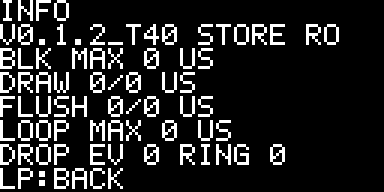

The version and the storage (`STORE RO`, read only, or `STORE OFF`); the
longest engine block since the power-on (`BLK MAX`); the last and the longest
screen draw and flush, in microseconds; the longest gap between two passes of
the main loop (from two seconds after the boot); and what the controls lost:
`DROP EV`, the events the input queue had no room for, and `RING`, the 1 ms
samples the sampler's buffer had no room for (a turn's detents are kept even
then; a button press shorter than the gap can be missed). They start again at
every boot.

## The safe mode

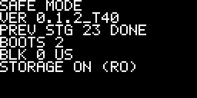

To start in safe mode, hold the **RIGHT** button while you power on. This is
what `setup()` in `firmware/oc_platform.cpp` does:

- After the button pins get their pull-ups, it waits **25 ms** for them to settle.
- It then reads the pins **3 times, 10 ms apart**. A button counts as held only if
  its pin reads low on **all three** samples.
- The calibration, which says which pin is the RIGHT (BOTTOM) button, has not
  been read yet. So either of the two button pins (4 and 5) is accepted. In
  practice either button held at power-on starts the safe mode.

In the safe mode the module runs:

- the calibration;
- the CV outs at 0 V;
- the display.

The engine, the storage, the USB MIDI and the tick do not run. The screen is
redrawn four times a second. It shows the version, the stage the previous run
reached, the boot count, the longest engine block and whether the storage is
there (it is always read only).

No control does anything in the safe mode. Power the module off and on to leave it.

## The crash pager

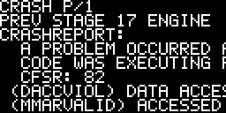
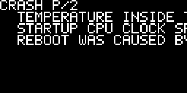

If the module faulted in the run before, `oc_diag_crash()` in
`firmware/oc_diag.cpp` shows the framework's crash report at power-on, before the
splash. The first line is the stage the previous run reached. After that comes
the report, seven lines to a page.

| Button | In the crash pager |
|---|---|
| **LEFT** (TOP) | the next page (after the last page it goes back to the first) |
| **RIGHT** (BOTTOM) | go on with the boot |

The pager first waits until both buttons are released, so a button already held
at power-on does not count. After that each press has to be released before the
next one counts. There is no timeout, on purpose: a module in a reboot loop
stops on a screen that says what happened. The report text in the pictures is an
example written in the framework's own layout.

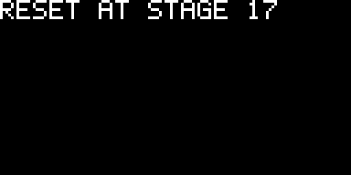

With no report but a boot that stopped part of the way through, the screen shows
`RESET AT STAGE n` for five seconds and the boot goes on. These are the stages:

| Stage | Step |
|---|---|
| 10 | setup |
| 11 | the pins |
| 12 | the SPI |
| 13 | the DAC |
| 14 | the calibration |
| 15 | the display |
| 16 | the splash |
| 17 | the engine |
| 18 | the storage |
| 19 | the project |
| 20 | the UI |
| 21 | the USB MIDI |
| 22 | the timer |
| 23 | done |
| 99 | running |

## Regenerating the pictures

```sh
tools/build_host.sh build      # the engine's generated tables (build/gen)
tools/render_screens.sh        # writes docs/img/screen-*.png
```

The pictures come from the code, so a change to a screen means rendering them
again and committing the new PNGs. `tools/build_host.sh` (and so CI's host job)
renders them into `build/render_check` and stops with
`docs/img stale: run tools/render_screens.sh` if a screen differs, is missing
or is left over in `docs/img`. The renderer runs on Linux only (it maps the
firmware's fixed debug-register addresses); elsewhere `tools/build_host.sh`
skips the check and says so. The panel drawing (`docs/img/panel.svg`) is drawn
by hand.
